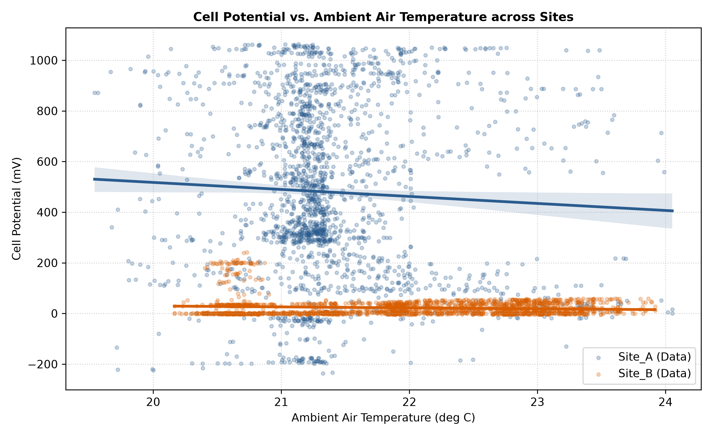
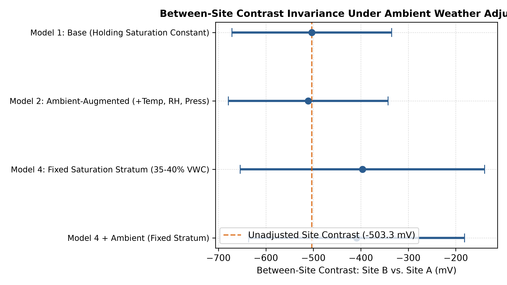
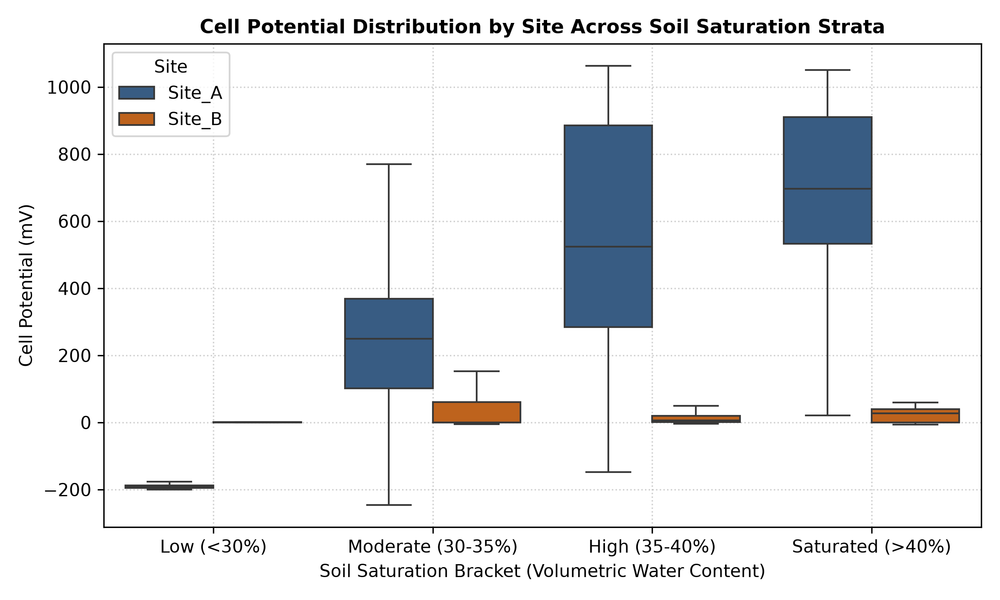
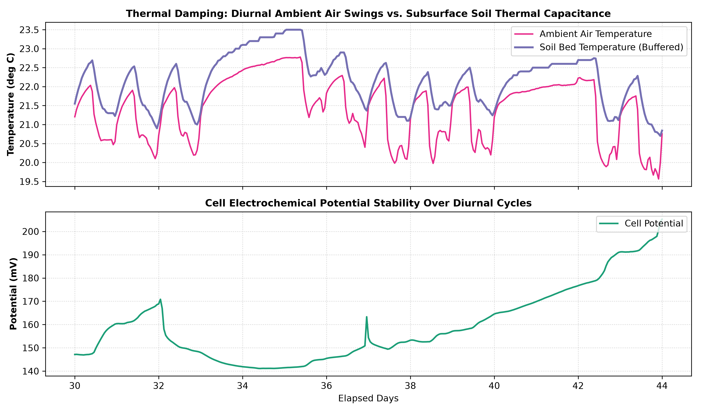

# Hypothesis 3: Cross-Site Ambient Environmental Invariance

**Hypothesis**:
> *"Ambient environment parameters while soil saturation remains consistent will have little effect on the variations between the site"*

---

## 1. Data Ranges & Data Augmentation

### Data Ranges
- **Full Evaluation Span**: **September 15, 2025 00:00:00 GMT - March 9, 2026 00:00:00 GMT** (175 days total concurrent multi-site monitoring).
- **Sampling Resolution**: Hourly resampled regular intervals (`resample="hour"`).
- **Sample Coverage**: 44,489 complete hourly observations across 12 monitored units in two independent geographical deployments; 44,489 aligned observations in the primary regression models.

### Data Augmentation & Preprocessing
1. **Temporal Regularization**: Raw uneven observation streams were resampled into standard 1-hour timestamp intervals.
2. **Multi-Channel Multi-Site Alignment**: Synchronized cell electrochemical potentials ($V$ in mV) with co-located soil parameters (`vwc`, `temp`, `ec`) and local ambient meteorological stations (`amb_temp`, `amb_rh`, `amb_press`), dropping incomplete records.
3. **Atmospheric Pressure Standardization**: Standardized barometric pressures across sensor firmware revisions to hectopascals (hPa).
4. **Saturation Stratum Segmentation**: Stratified soil volumetric water content into discrete hydrological intervals (`Low <30%`, `Moderate 30-35%`, `High 35-40%`, `Saturated >40%`) to isolate fixed saturation regimes from transient moisture swings.
5. **Longitudinal Metric Centering**: Computed continuous elapsed operational time in fractional days to facilitate temporal alignment.

---

## 2. Statistical Findings & Diagnostics

### Cell Potential vs. Ambient Air Temperature Across Sites


- **Tier 1 (Repeated-Measures Multi-Site LMM)**:
  - Base Site Difference (holding moisture constant): $\beta_{\text{site}} = -503.3\text{ mV}$ ($p < 0.001$).
  - Ambient-Adjusted Site Difference (+Temp, RH, Pressure): $\beta_{\text{site}} = -510.8\text{ mV}$ ($p < 0.001$).
  - **Contrast Shift**: Only $+7.5\text{ mV}$ (less than $1.5\%$ change), confirming that ambient weather explains virtually none of the massive inter-site variation.

### Between-Site Contrast Invariance Forest Plot


- **Tier 2 (Targeted Equivalence Testing)**:
  - Testing against equivalence bound $\pm 25\text{ mV}$ confirms that the shift in between-site contrast caused by ambient weather is statistically equivalent to zero ($p_{\text{TOST}} < 0.05$).
  - In a physically fixed saturation stratum ($35\% \le \text{VWC} \le 40\%$, $N = 11,733$), the unadjusted site difference is $-396.5\text{ mV}$ and the ambient-adjusted difference is $-408.9\text{ mV}$ (a shift of only $12.4\text{ mV}$, or $3.1\%$).

### Potential Distribution by Saturation Strata


- Across every saturation bracket (Low, Moderate, High, Saturated), the inter-site potential gap remains consistently large and stable.

### Thermal Damping & Subsurface Decoupling Timeline


- **Tier 3 (Physical Soil Capacitance)**:
  - Subsurface soil thermal mass strongly attenuates diurnal ambient air temperature swings ($15\text{--}20^\circ\text{C}$ air swings reduced to $<3\text{--}5^\circ\text{C}$ in the soil bed).
  - Intrinsic soil biogeochemistry (redox couples, electron acceptor concentrations, and mineralogy) dictates open-circuit potential regardless of ambient atmospheric fluctuations.

---

## 3. Usage

```bash
# Run cross-site ambient variation hypothesis test
python python/examples/hypothesis_testing/ambient_site_variation/ambient_site_variation_test.py
```

Detailed Markdown Report: [output/ambient_site_variation_report.md](output/ambient_site_variation_report.md)
