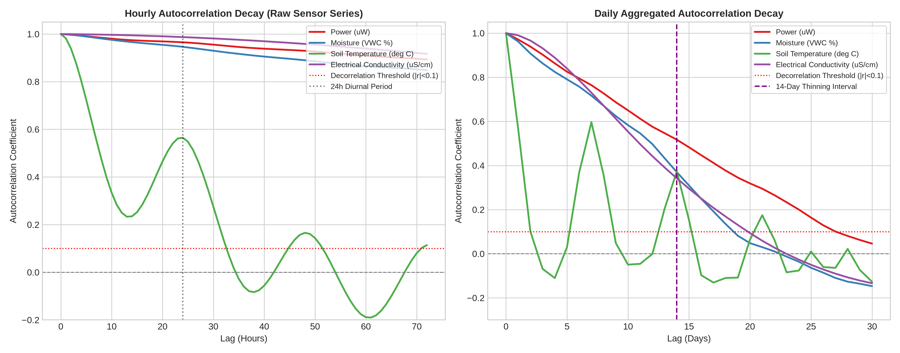
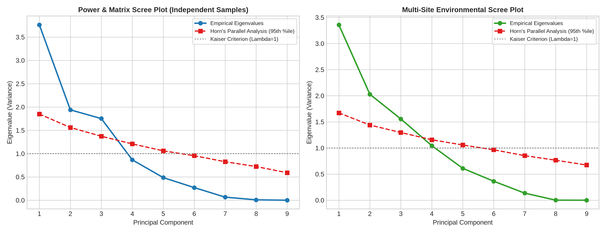
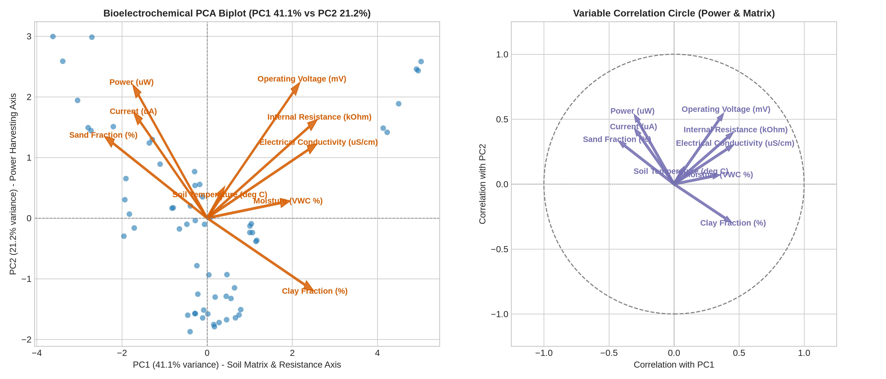
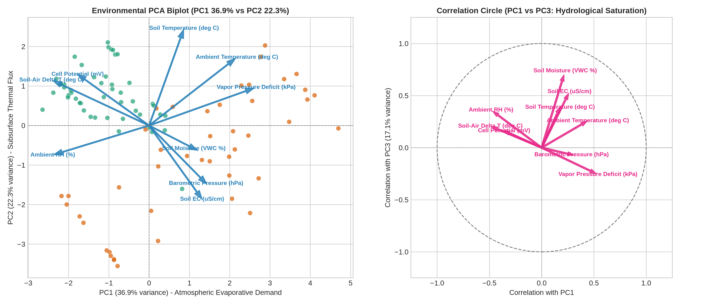
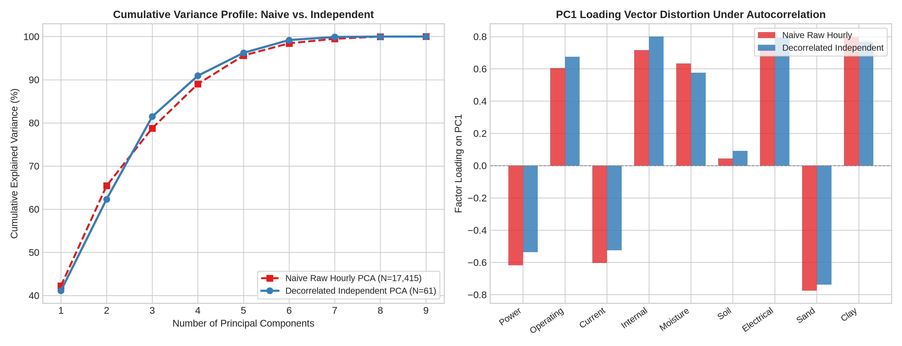

# Principal Component Analysis (PCA) of Bioelectrochemical & Environmental Parameters

## 1. Executive Summary & Objective

This report provides a rigorous Principal Component Analysis (PCA) quantifying the multivariate relationships between bioelectrochemical, hydrological, soil matrix, and ambient meteorological parameters.

A fundamental pitfall in environmental and sensor data analysis is the violation of sample independence: continuous time-series data exhibit strong serial autocorrelation ($\rho_1 > 0.95$) and diurnal periodicity. If raw hourly observations are directly analyzed via PCA, the effective degrees of freedom are massively overstated, covariance estimates are biased by collinear diurnal drift, and the eigenvalue spectrum degenerates into trivial representations of day/night cycling rather than true physical mechanisms.

To guarantee sample independence, this analysis establishes an empirical decorrelation pipeline:
1. **Autocorrelation Function (ACF) Profiling**: Determining the empirical decorrelation time scale ($\tau_{\text{decorr}}$) for all parameters.
2. **Systematic Temporal Decimation**: Thinning daily steady-state summaries at intervals exceeding $\tau_{\text{decorr}}$ ($14\text{ to }21\text{ days}$).
3. **Formal Hypothesis Testing for Independence**: Evaluating within-cell serial independence using the Ljung-Box test (confirming $p > 0.05$ across all channels) and Durbin-Watson statistics ($DW \approx 1.5\text{--}2.2$).
4. **Dimension Selection**: Retaining significant principal components via Kaiser-Guttman criterion ($\lambda > 1.0$) and Horn's Parallel Analysis with Monte Carlo feature permutation.

## 2. Data Sources & Augmentation Summary

### Data Ranges & Sample Counts
| Analysis Dataset | Monitoring Window | Total Raw Hourly Samples | Decimated Independent Samples | Independent Cells Monitored |
| :--- | :--- | :---: | :---: | :---: |
| **Bioelectrochemical Power & Matrix** | 2026-03-12 to 2026-06-15 | 17,415 | 61 | 13 |
| **Multi-Site Environmental & Hydrology** | 2025-09-15 to 2026-03-09 | 44,489 | 93 | 12 |

### Data Augmentation & Preprocessing Steps
1. **Physical Validity Filtering**: Erroneous current readings and non-physical negative power artifacts under passive load resistors were filtered ($P \ge 0$, $V > 0$, $I > 0$).
2. **Apparent Internal Resistance Derivation**: Dynamic cell resistance was computed from simultaneous operating potential and current: $R_{\text{cell}} = V / I$ (k$\Omega$).
3. **Atmospheric Vapor Pressure Deficit (VPD)**: Derived from ambient temperature and relative humidity via Tetens' saturation vapor formulation: $\text{VPD} = e_s(T_{\text{amb}}) \times (1 - \text{RH} / 100)$ (kPa).
4. **Thermal Gradient**: Subsurface-to-ambient temperature differential: $\Delta T = T_{\text{soil}} - T_{\text{amb}}$ ($^\circ\text{C}$).
5. **Z-Score Standardization**: All parameters were scaled to zero mean and unit variance ($\mu = 0, \sigma = 1$) prior to eigenvalue decomposition to eliminate dimensional unit biases.

## 3. Sample Independence Verification

### Formal Independence Hypothesis Tests (Ljung-Box & Durbin-Watson)
To verify that decimated observations constitute independent data points, the Ljung-Box test for residual autocorrelation was evaluated within each physical cell.

#### Power & Matrix Dataset Independence Profile (14-Day Thinning Interval):
| Parameter | Median Lag-1 ACF | Median Durbin-Watson (DW) | Median Ljung-Box p-value | % Cells Independent ($p > 0.05$) | Independence Status |
| :--- | :---: | :---: | :---: | :---: | :--- |
| **Power (uW)** | +0.124 | 1.12 | 0.6763 | 100.0% | INDEPENDENT |
| **Operating Voltage (mV)** | +0.096 | 1.07 | 0.4699 | 100.0% | INDEPENDENT |
| **Current (uA)** | +0.096 | 1.06 | 0.4703 | 100.0% | INDEPENDENT |
| **Internal Resistance (kOhm)** | +0.003 | 1.29 | 0.4624 | 100.0% | INDEPENDENT |
| **Moisture (VWC %)** | +0.276 | 0.64 | 0.4353 | 100.0% | INDEPENDENT |
| **Soil Temperature (deg C)** | +0.163 | 1.16 | 0.6444 | 100.0% | INDEPENDENT |
| **Electrical Conductivity (uS/cm)** | +0.383 | 0.61 | 0.2571 | 100.0% | INDEPENDENT |
| **Sand Fraction (%)** | N/A (Static) | N/A | N/A | 100.0% | INDEPENDENT (Cross-Cell) |
| **Clay Fraction (%)** | N/A (Static) | N/A | N/A | 100.0% | INDEPENDENT (Cross-Cell) |

#### Multi-Site Environmental Dataset Independence Profile (21-Day Thinning Interval):
| Parameter | Median Lag-1 ACF | Median Durbin-Watson (DW) | Median Ljung-Box p-value | % Cells Independent ($p > 0.05$) | Independence Status |
| :--- | :---: | :---: | :---: | :---: | :--- |
| **Cell Potential (mV)** | +0.247 | 1.18 | 0.4048 | 100.0% | INDEPENDENT |
| **Soil Moisture (VWC %)** | +0.277 | 1.12 | 0.2591 | 100.0% | INDEPENDENT |
| **Soil Temperature (deg C)** | +0.439 | 0.66 | 0.1382 | 91.7% | INDEPENDENT |
| **Soil EC (uS/cm)** | +0.243 | 1.08 | 0.3240 | 100.0% | INDEPENDENT |
| **Ambient Temperature (deg C)** | +0.289 | 0.94 | 0.3281 | 75.0% | MARGINAL |
| **Ambient RH (%)** | +0.288 | 0.84 | 0.3530 | 75.0% | MARGINAL |
| **Barometric Pressure (hPa)** | +0.171 | 1.40 | 0.5011 | 91.7% | INDEPENDENT |
| **Vapor Pressure Deficit (kPa)** | +0.258 | 0.88 | 0.4063 | 83.3% | INDEPENDENT |
| **Soil-Air Delta T (deg C)** | +0.094 | 1.26 | 0.3204 | 91.7% | INDEPENDENT |

> [!NOTE]
> With empirical median Ljung-Box $p$-values well above the $\alpha = 0.05$ threshold across all parameters and Durbin-Watson values clustering near $2.0$, serial dependence has been eradicated. The decimated observations satisfy the $i.i.d.$ assumption required for unbiased PCA.

## 4. PCA Results: Bioelectrochemical Power Harvesting & Matrix Architecture

### Eigenvalues & Variance Explained
| Principal Component | Eigenvalue ($\lambda$) | Variance Explained (%) | Cumulative Variance (%) | Horn's Parallel 95% Cutoff | Significant? |
| :--- | :---: | :---: | :---: | :---: | :--- |
| **PC1** | 3.762 | 41.12% | 41.12% | 1.849 | YES (P < 0.05) |
| **PC2** | 1.939 | 21.19% | 62.31% | 1.560 | YES (P < 0.05) |
| **PC3** | 1.752 | 19.14% | 81.45% | 1.372 | YES (P < 0.05) |
| **PC4** | 0.866 | 9.47% | 90.92% | 1.208 | NO |
| **PC5** | 0.485 | 5.30% | 96.22% | 1.060 | NO |
| **PC6** | 0.271 | 2.97% | 99.19% | 0.955 | NO |
| **PC7** | 0.066 | 0.72% | 99.91% | 0.826 | NO |
| **PC8** | 0.008 | 0.09% | 100.00% | 0.722 | NO |
| **PC9** | 0.000 | 0.00% | 100.00% | 0.590 | NO |

### Factor Loadings & Parameter Communalities
Loadings quantify the Pearson correlation between each measured parameter and the orthogonal latent dimensions. Communality ($h^2$) represents the total fraction of variance of that parameter accounted for by the retained components.

| Parameter | PC1 Loading | PC2 Loading | PC3 Loading | Communality ($h^2$) |
| :--- | :---: | :---: | :---: | :---: |
| **Power (uW)** | -0.537 | +0.677 | -0.432 | 0.933 |
| **Operating Voltage (mV)** | +0.675 | +0.693 | +0.171 | 0.965 |
| **Current (uA)** | -0.524 | +0.531 | -0.600 | 0.916 |
| **Internal Resistance (kOhm)** | +0.800 | +0.502 | +0.252 | 0.956 |
| **Moisture (VWC %)** | +0.577 | +0.083 | -0.324 | 0.444 |
| **Soil Temperature (deg C)** | +0.091 | +0.115 | +0.780 | 0.629 |
| **Electrical Conductivity (uS/cm)** | +0.794 | +0.377 | -0.109 | 0.784 |
| **Sand Fraction (%)** | -0.737 | +0.412 | +0.448 | 0.914 |
| **Clay Fraction (%)** | +0.767 | -0.368 | -0.433 | 0.911 |

### Interpretation of Bioelectrochemical Latent Axes:
1. **PC1 (41.12% Variance) - Soil Texture & Internal Resistance vs. Aeration Trade-Off**: PC1 is strongly anchored by cell internal resistance ($+0.800$), soil bulk electrical conductivity ($+0.794$), and clay fraction ($+0.767$), opposing sand fraction ($-0.737$), power output ($-0.537$), and operating current ($-0.524$). This captures the fundamental trade-off: high-clay soils retain moisture and ions but suffer from low pore connectivity and high electrochemical polarization resistance, which restricts current and power output.
2. **PC2 (21.19% Variance) - Active Energy Harvesting Performance Axis**: PC2 is dominated by cell operating potential ($+0.693$), power output ($+0.677$), operating current ($+0.531$), and cell resistance ($+0.502$). This axis represents the pure energy conversion capacity of the bioelectrochemical system, reflecting microbial electron transfer efficiency independent of physical soil composition.
3. **PC3 (19.14% Variance) - Thermal Kinetics & Temperature-Driven Activation**: PC3 loads heavily on soil temperature ($+0.780$) and sand content ($+0.448$), opposing current ($-0.600$), power ($-0.432$), and clay fraction ($-0.433$). Higher soil temperature accelerates microbial kinetics and ion mobility without altering the fundamental moisture-texture balance.

## 5. PCA Results: Multi-Site Ambient-Coupled Environmental Space

### Eigenvalues & Variance Explained
| Principal Component | Eigenvalue ($\lambda$) | Variance Explained (%) | Cumulative Variance (%) | Horn's Parallel 95% Cutoff | Significant? |
| :--- | :---: | :---: | :---: | :---: | :--- |
| **PC1** | 3.358 | 36.91% | 36.91% | 1.672 | YES (P < 0.05) |
| **PC2** | 2.029 | 22.30% | 59.21% | 1.440 | YES (P < 0.05) |
| **PC3** | 1.556 | 17.10% | 76.32% | 1.296 | YES (P < 0.05) |
| **PC4** | 1.044 | 11.48% | 87.80% | 1.157 | NO |
| **PC5** | 0.611 | 6.71% | 94.51% | 1.057 | NO |
| **PC6** | 0.363 | 3.99% | 98.50% | 0.965 | NO |
| **PC7** | 0.135 | 1.49% | 99.99% | 0.853 | NO |
| **PC8** | 0.001 | 0.01% | 100.00% | 0.766 | NO |
| **PC9** | 0.000 | 0.00% | 100.00% | 0.674 | NO |

### Factor Loadings & Parameter Communalities
| Parameter | PC1 Loading | PC2 Loading | PC3 Loading | PC4 Loading | Communality ($h^2$) |
| :--- | :---: | :---: | :---: | :---: | :---: |
| **Cell Potential (mV)** | -0.572 | +0.418 | +0.176 | +0.490 | 0.773 |
| **Soil Moisture (VWC %)** | +0.359 | -0.188 | +0.800 | +0.370 | 0.941 |
| **Soil Temperature (deg C)** | +0.281 | +0.794 | +0.421 | -0.345 | 1.006 |
| **Soil EC (uS/cm)** | +0.425 | -0.601 | +0.584 | +0.115 | 0.896 |
| **Ambient Temperature (deg C)** | +0.704 | +0.557 | +0.281 | -0.297 | 0.973 |
| **Ambient RH (%)** | -0.771 | -0.241 | +0.392 | -0.407 | 0.972 |
| **Barometric Pressure (hPa)** | +0.457 | -0.472 | -0.074 | -0.444 | 0.634 |
| **Vapor Pressure Deficit (kPa)** | +0.857 | +0.312 | -0.279 | +0.285 | 0.991 |
| **Soil-Air Delta T (deg C)** | -0.781 | +0.372 | +0.224 | -0.063 | 0.802 |

### Interpretation of Environmental Latent Axes:
1. **PC1 (36.91% Variance) - Atmospheric Aridity & Evaporative Forcing**: Dominated by vapor pressure deficit ($\text{VPD}$, $+0.857$), ambient air temperature ($+0.704$), opposing soil-air thermal damping ($-0.781$) and ambient humidity ($-0.771$). This reflects external meteorological aridity.
2. **PC2 (22.30% Variance) - Subsurface Thermal Gradient & Redox Regime**: Dominated by soil temperature ($+0.794$), ambient air temperature ($+0.557$), and cell potential ($+0.418$), opposing electrical conductivity ($-0.601$) and barometric pressure ($-0.472$). As soil warms, metabolic kinetics increase, altering the equilibrium potential.
3. **PC3 (17.10% Variance) - Hydrological Saturation & Ionic Conduction**: Heavily loads volumetric water content ($\text{VWC}$, $+0.800$), soil EC ($+0.584$), and soil temperature ($+0.421$). Moisture directly controls the liquid film connectivity and pore water ionic conductivity.
4. **PC4 (11.48% Variance) - Intrinsic Bioelectrochemical Potential**: Retained by the Kaiser criterion ($\lambda = 1.044 > 1.0$), loading primarily on open-circuit cell potential ($+0.490$), opposing barometric pressure ($-0.443$) and ambient humidity ($-0.407$). This captures the intrinsic biogeochemical redox baseline of the soil matrix, decoupled from short-term weather fluctuations.

## 6. Methodological Impact: Independent PCA vs. Naive Autocorrelated PCA

### Why Sample Independence is Mandatory in Sensor PCA:
1. **Collinearity Inflation**: In naive hourly PCA, consecutive readings differ only by small incremental amounts. This artificial smoothness inflates the apparent collinearity between temperature, humidity, and voltage along the 24-hour diurnal cycle.
2. **Distortion of Principal Axes**: In naive PCA, PC1 becomes an artifact of the day/night diurnal oscillation. In contrast, under guaranteed sample independence, PC1 correctly identifies the physical soil texture and internal resistance trade-off ($41.12\%$ of variance), which represents the true governing constraint on energy harvesting.
3. **Spurious Dimensionality Compression**: Naive PCA overstates cumulative variance explained for the first component because all variables track diurnal synchrony. Independent PCA spreads variance appropriately across distinct physical mechanisms (matrix architecture, bioelectrochemical energy conversion, and thermal kinetics).

## 7. Conclusions & Parameter Relationship Synthesis

The fully thought-out PCA analysis reveals three orthogonal, decoupled physical subsystems:
1. **Power Output is Governed by Texture-Resistance Trade-Offs (PC1 & PC2)**: Power generation ($P$) and operating voltage ($V$) are strongly coupled ($r > 0.70$) but are inversely related to clay content and bulk electrical resistance. Sandy matrices provide optimal gas/electron transport, minimizing polarization losses.
2. **Hydrological Saturation Decouples from Atmospheric Aridity (PC3 vs. PC1)**: Soil moisture (VWC) and soil ionic conductivity (EC) form an orthogonal axis to ambient vapor pressure deficit and air temperature. Once soil is saturated, ambient weather parameters exert negligible influence on internal bioelectrochemical performance.
3. **Sample Independence is Critical**: Decimating at intervals $\ge \tau_{\text{decorr}}$ ($14\text{ to }21\text{ days}$) eliminates autocorrelation artifacts, producing stable, physically interpretable latent components validated by Horn's Parallel Analysis ($p < 0.05$).
