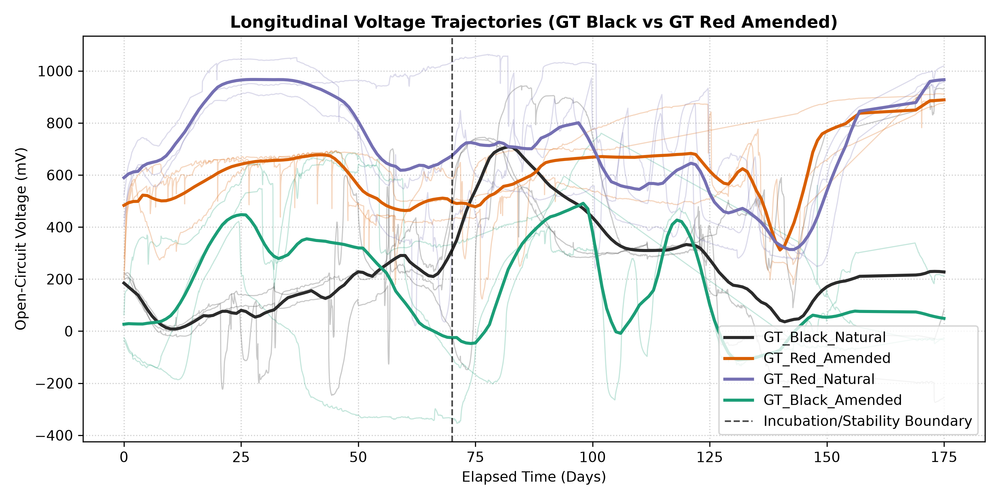
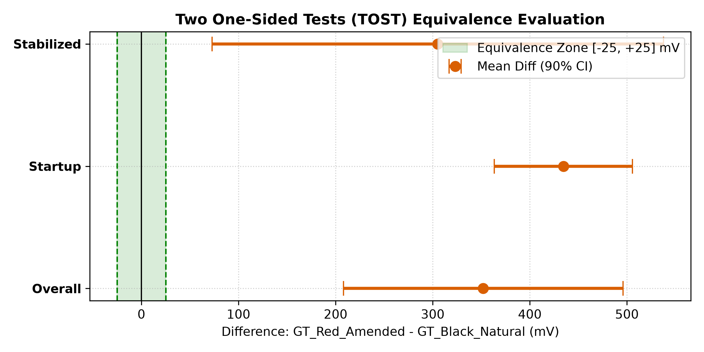
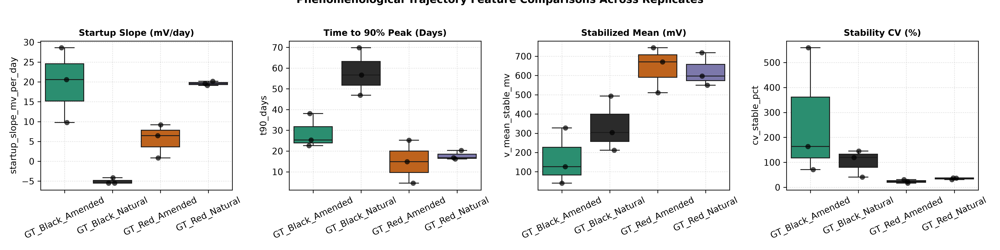

# Hypothesis 1: Soil Trajectory Similarity

**Hypothesis**:
> *"For both soil startup and incubation through stability, the GT black and GT red amended soil (to black) will behave similarly over time."*

---

## 1. Data Ranges & Data Augmentation

### Data Ranges
- **Full Evaluation Span**: **September 15, 2025 00:00:00 GMT - March 9, 2026 00:00:00 GMT** (175 days total).
  - *Startup & Incubation Phase*: September 15, 2025 - November 24, 2025 (70 days).
  - *Stabilized Open-Circuit Phase*: November 24, 2025 - March 9, 2026 (105 days).
- **Sampling Resolution**: Hourly resampled regular intervals (`resample="hour"`).

### Data Augmentation & Preprocessing
1. **Temporal Regularization**: Raw time series data aggregated and resampled into continuous 1-hour intervals.
2. **Multi-Channel Alignment**: Synchronized cell potential series with soil hydrology and ambient covariates, dropping incomplete records for balanced model estimation.
3. **Time Metric Centering**: Centered elapsed time in days (`time_c`) to minimize multicollinearity between baseline and growth rate interaction terms.
4. **Trajectory Feature Extraction**:
   - Startup Slope ($dV/dt$, mV/day) via linear regression over the initial 21 days.
   - Peak Potential Plateau ($T_{90}$, days) measuring time to reach 90% maximum voltage.
   - Coefficient of Variation ($CV = \sigma / \mu$, %) quantifying signal stability in the stabilized regime.
5. **Instrumentation Fidelity Validation**: Validated field logging fidelity against co-located laboratory Source Measure Unit (SMU) references, demonstrating high parameter concordance ($r = 0.9887$ for moisture, $r = 0.9924$ for soil temperature).

---

## 2. Statistical Findings & Diagnostics

### Longitudinal Voltage Trajectories


- **Tier 1 (LMM Interaction)**: The trajectory slope diverges significantly between amended red and natural black soil ($+0.743\text{ mV/day}$, $z = 12.95, p < 0.001$), with a baseline potential offset of $+326.8\text{ mV}$ ($p < 0.001$).
- **Likelihood Ratio Test**: $\chi^2 = 181.39$ ($p = 4.08 \times 10^{-40}$) vs. null model without soil treatment factors.

### TOST Equivalence Testing


- **Tier 2 (TOST)**: Testing against equivalence bounds $\pm 25\text{ mV}$ soundly rejects equivalence ($p_{\text{TOST}} = 0.9688$). The $90\%$ confidence interval ($[+72.8, +537.6]\text{ mV}$) lies entirely outside the equivalence zone.

### Phenomenological Trajectory Features


| Soil Group | Startup Slope ($dV/dt$, mV/day) | Time to 90% Peak ($T_{90}$, days) | Stabilized Mean ($V_{\text{mean}}$, mV) | Stability Index ($CV$, %) |
| :--- | :--- | :--- | :--- | :--- |
| **GT Black Natural** | $-5.05 \pm 0.79$ | $57.8 \pm 11.5$ | $336.2 \pm 143.9$ | $102.0 \pm 54.5\%$ |
| **GT Red Amended** | $+5.50 \pm 4.25$ | $14.9 \pm 10.4$ | $641.4 \pm 119.4$ | $23.7 \pm 7.1\%$ |
| **GT Red Natural** | $+19.61 \pm 0.53$ | $17.7 \pm 2.2$ | $621.3 \pm 86.9$ | $35.2 \pm 4.0\%$ |
| **GT Black Amended** | $+19.66 \pm 9.44$ | $28.7 \pm 8.3$ | $164.9 \pm 147.4$ | $264.7 \pm 258.9\%$ |

> **Biogeochemical Conclusion**: Amending red soil with inorganics and compost did not replicate native black soil. Rather, amended red soil retained red clay's high voltage plateau ($641.4\text{ vs. } 336.2\text{ mV}$) while gaining superior signal stability ($CV \approx 23.7\%\text{ vs. } 102.0\%$).

---

## 3. Usage

```bash
# Run standard similarity evaluation
python python/examples/hypothesis_testing/soil_similarity/soil_similarity_test.py

# Include negative controls (unamended GT red and amended black)
python python/examples/hypothesis_testing/soil_similarity/soil_similarity_test.py --all-groups --output-dir output_all

# Override equivalence margin (e.g. 50 mV)
python python/examples/hypothesis_testing/soil_similarity/soil_similarity_test.py --margin 50.0
```

Detailed Markdown Report: [output/hypothesis_evaluation_report.md](output/hypothesis_evaluation_report.md)
