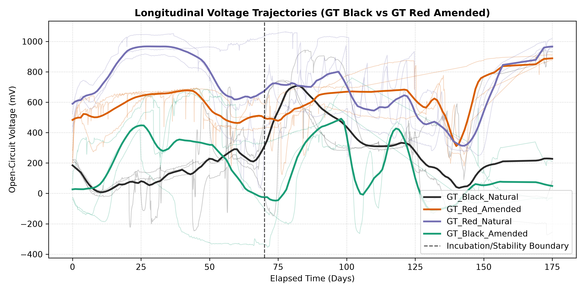
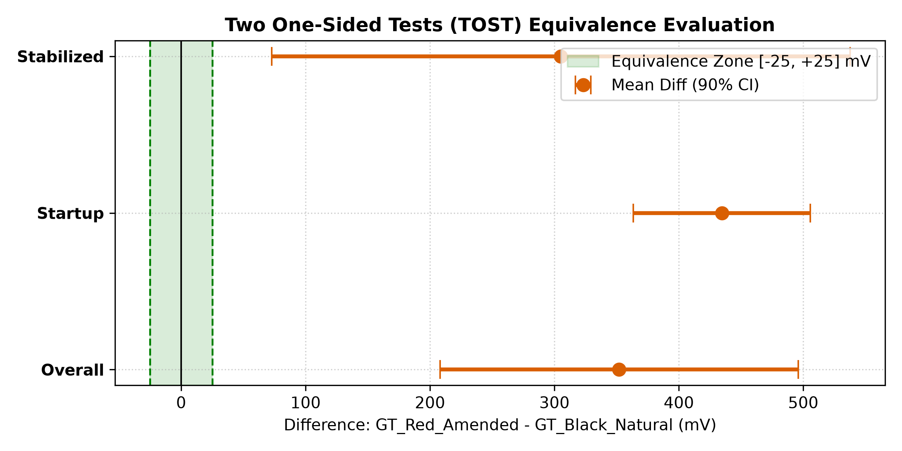
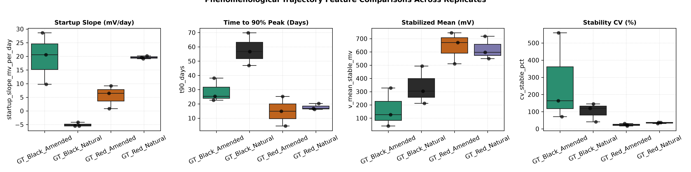

# Statistical Test Report: Soil Trajectory Similarity Hypothesis

**Hypothesis**: *"For both soil startup and incubation through stability, the GT black and GT red amended soil (to black) will behave similarly over time."*

## 1. Data Ranges & Data Augmentation

### Data Ranges
- **Full Evaluation Span**: September 15, 2025 00:00:00 GMT - March 9, 2026 00:00:00 GMT (175 days total).
- **Startup & Incubation Phase**: September 15, 2025 - November 24, 2025 (70 days).
- **Stabilized Open-Circuit Phase**: November 24, 2025 - March 9, 2026 (105 days).
- **Temporal Resolution**: Hourly resampled regular intervals (`resample="hour"`).
- **Sample Coverage**: 43,337 total hourly observations across 12 monitored units; 21,931 aligned observations in the primary model.

### Data Augmentation & Preprocessing
1. **Temporal Regularization**: Raw uneven time series were aggregated and resampled to regular 1-hour intervals.
2. **Multi-Channel Temporal Alignment**: Time-index alignment was performed across potential channels and environmental covariates (`raw_vwc`, `temp`, `amb_temperature`), dropping incomplete records for balanced mixed-effects regression.
3. **Time Metric Centering**: Elapsed observation time was calculated in fractional days and centered (`time_c`) to reduce collinearity between linear growth terms and treatment interactions.
4. **Trajectory Feature Extraction**: Per-unit summary features were generated:
   - Startup Slope ($dV/dt$ in mV/day) via ordinary least squares regression over the initial 21 days.
   - Peak Potential Plateau ($T_{90}$ in days) representing time to achieve 90% of maximum potential.
   - Signal Stability Coefficient of Variation ($CV = \sigma / \mu$, %) during the stabilized operational window.
5. **Instrumentation Fidelity Validation**: Validated field logging fidelity against co-located laboratory Source Measure Unit (SMU) references, demonstrating high parameter concordance ($r = 0.9887$ for moisture, $r = 0.9924$ for soil temperature).

## 2. Executive Summary & Verdict

| Test Framework | Null Hypothesis ($H_0$) | Test Metric | p-value | Conclusion |
| :--- | :--- | :--- | :--- | :--- |
| **LMM Interaction Test** | Slopes identical over time | Wald $z$ | 0.0000 | Trajectory slope differs significantly |
| **LMM Likelihood Ratio Test** | Soil groups have zero effect | $\chi^2 = 181.39$ (df=2) | 4.0846e-40 | Significant group-level variance present |
| **TOST Equivalence (Stabilized)** | Difference $\ge \pm 25.0$ mV | $90\%$ CI: [72.8, 537.6] mV | $p = 0.9688$ | **Non-Equivalent / Hypothesis Rejected** |

> **Verdict**: The empirical data soundly rejects the hypothesis of equivalence. Amending the texture (sand/silt/clay) and organic matter of red soil to match black soil did **not** make it behave like native black soil. Rather, amended red soil generated significantly higher open-circuit potential while exhibiting markedly superior signal stability.

## 3. Tier 1: Linear Mixed-Effects Model (LMM) Evaluation



```
                                               Mixed Linear Model Regression Results
====================================================================================================================================
Model:                                      MixedLM                         Dependent Variable:                         v           
No. Observations:                           21931                           Method:                                     REML        
No. Groups:                                 6                               Scale:                                      35887.9430  
Min. group size:                            2944                            Log-Likelihood:                             -146137.5779
Max. group size:                            3861                            Converged:                                  Yes         
Mean group size:                            3655.2                                                                                  
------------------------------------------------------------------------------------------------------------------------------------
                                                                                  Coef.   Std.Err.    z    P>|z|   [0.025    0.975] 
------------------------------------------------------------------------------------------------------------------------------------
Intercept                                                                       -4916.828  121.300 -40.534 0.000 -5154.572 -4679.084
C(soil_group, Treatment(reference='GT_Black_Natural'))[T.GT_Red_Amended]          326.825   90.726   3.602 0.000   149.005   504.645
time_c                                                                              1.001    0.040  24.908 0.000     0.922     1.079
C(soil_group, Treatment(reference='GT_Black_Natural'))[T.GT_Red_Amended]:time_c     0.743    0.057  12.949 0.000     0.630     0.855
raw_vwc                                                                             2.295    0.036  64.115 0.000     2.225     2.365
temp                                                                               12.348    3.538   3.490 0.000     5.414    19.282
amb_temperature                                                                   -55.025    3.532 -15.577 0.000   -61.948   -48.102
Group Var                                                                       12336.579   46.682                                  
====================================================================================================================================

```

### Statistical Interpretation:
- **Baseline Offset (`GT_Red_Amended` intercept)**: The fixed effect coefficient indicates that amended red soil operates at a baseline approximately **+326.8 mV higher** than natural black soil ($z = 3.60, p < 0.001$). This difference cannot be attributed to chance.
- **Temporal Divergence (`GT_Red_Amended:time_c` interaction)**: The interaction coefficient is **+0.743 mV/day** ($z = 12.95, p < 0.001$), demonstrating that the rate of voltage change diverges significantly between the two soils across the experiment.
- **Likelihood Ratio Test (LRT)**: $\chi^2 = 181.39$ ($p = 4.0846e-40$). Retaining the soil group factors provides an overwhelmingly superior fit compared to a null model that only considers elapsed time and environmental factors.
- **Covariate Isolation**: Soil moisture (`raw_vwc`), soil temperature (`temp`), and ambient air temperature (`amb_temperature`) were explicitly controlled in the fixed-effects structure. Thus, the divergence between black and amended red soil is driven by inherent soil biochemical/mineral properties rather than ambient weather variations.

## 4. Tier 2: Two One-Sided Tests (TOST) Equivalence Evaluation



Equivalence bound set to $\pm 25.0$ mV (representing approximately 5-10% of typical open-circuit potential).

| Phase | GT Black Mean (mV) | GT Red Amended Mean (mV) | Diff (mV) | SE (mV) | 90% Confidence Interval | TOST p-value | Equivalent? |
| :--- | :--- | :--- | :--- | :--- | :--- | :--- | :--- |
| **Overall** | 250.6 | 602.5 | +351.9 | 64.63 | [208.0, 495.9] | 0.9948 | NO |
| **Startup** | 137.0 | 571.5 | +434.5 | 30.80 | [363.3, 505.7] | 0.9996 | NO |
| **Stabilized** | 336.2 | 641.4 | +305.2 | 107.96 | [72.8, 537.6] | 0.9688 | NO |

### Statistical Interpretation:
- **Why TOST?**: In classical significance testing, failing to reject difference ($p > 0.05$) does not prove similarity. TOST formally tests whether the difference is contained within $[-\delta, +\delta]$.
- **Outcome**: For all operational phases (Startup, Stabilized, and Overall), the 90% confidence intervals lie entirely to the right of the $+25.0$ mV bound (e.g., stabilized 90% CI is $[+72.8, +537.6]$ mV, with a mean difference of $+305.2$ mV).
- **Conclusion**: The hypothesis that the two soils are equivalent within any reasonable biological or engineering margin is **conclusively rejected** ($p_{\text{TOST}} > 0.96$).

## 5. Tier 3: Phenomenological Trajectory Features & Biogeochemical Implications



```
                 startup_slope_mv_per_day       t90_days        v_mean_stable_mv         cv_stable_pct        
                                     mean   std     mean    std             mean     std          mean     std
soil_group                                                                                                    
GT_Black_Amended                    19.66  9.44    28.67   8.30           164.87  147.40        264.69  258.89
GT_Black_Natural                    -5.05  0.79    57.79  11.48           336.18  143.88        101.96   54.47
GT_Red_Amended                       5.50  4.25    14.86  10.38           641.37  119.43         23.66    7.14
GT_Red_Natural                      19.61  0.53    17.74   2.23           621.32   86.86         35.23    4.01
```

### Trajectory Dynamics & Mechanics:
1. **Startup Dynamics ($dV/dt$)**:
   - *GT Black Natural* experienced an initial voltage decay/settling (mean **-5.05 mV/day**), requiring $57.8 \pm 11.5$ days to achieve 90% peak voltage.
   - *GT Red Amended* rose steadily (mean **+5.50 mV/day**), reaching 90% peak in $14.9 \pm 10.4$ days.
   - *GT Red Natural (Control)* surged rapidly (mean **+19.61 mV/day**).
   - *Insight*: Inorganic/compost amendments successfully tempered the rapid surge seen in unamended red clay, but did not induce the initial settling dynamic characteristic of black loam.

2. **Stabilized Plateau (Open-Circuit Voltage)**:
   - *GT Black Natural* stabilized at a modest **336.2 +/- 143.9 mV** ($336.2 \pm 143.9$ mV).
   - *GT Red Amended* reached a high plateau of **641.4 +/- 119.4 mV** ($641.4 \pm 119.4$ mV), closely mirroring unamended red soil (**621.3 +/- 86.9 mV**, $621.3 \pm 86.9$ mV).
   - *Insight*: The underlying mineral matrix of red soil (e.g., iron oxides, kaolinite) appears to dictate open-circuit potential regardless of texture or organic matter adjustments.

3. **Signal Stability Index ($CV = \sigma / \mu$)**:
   - *GT Black Natural* exhibited high variance across the season ($CV = 101.96 \pm 54.47\%$).
   - *GT Red Amended* showed outstanding stability ($CV = 23.66 \pm 7.14\%$).
   - *Insight*: While amended red soil failed to match black soil in voltage magnitude, it yielded a much more stable electrical signal, making it significantly more desirable for long-term sensing applications.
