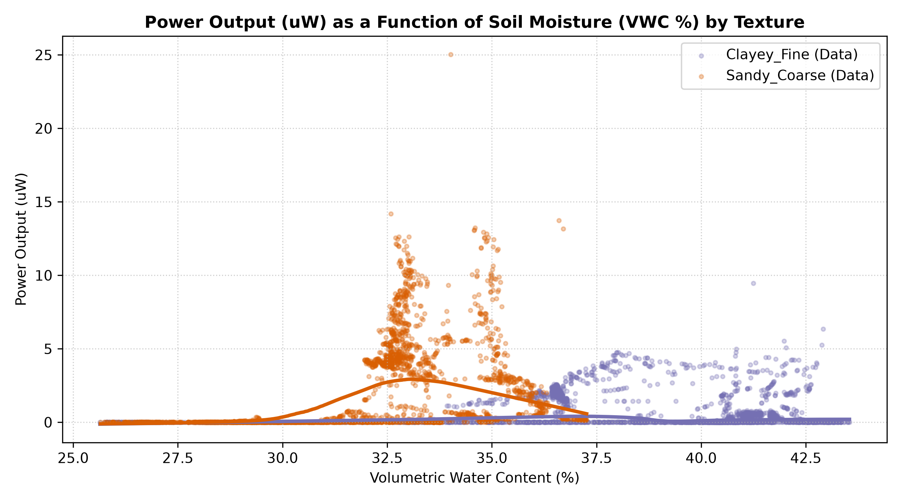
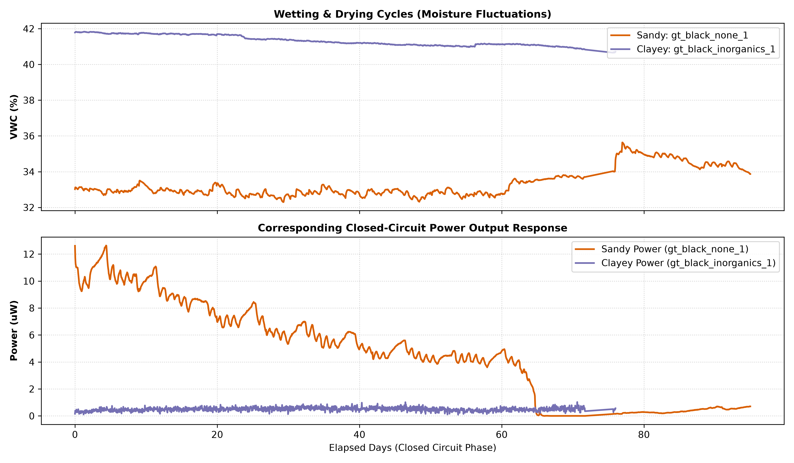
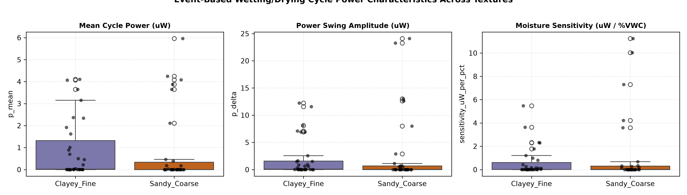
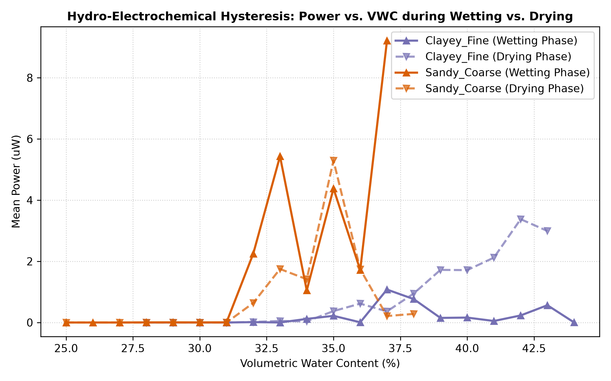

# Hypothesis 2: Soil Texture and Wetting/Drying Cycles

**Hypothesis**:
> *"Soil texture/soil wetting and drying cycles impacts the power output"*

---

## 1. Data Ranges & Data Augmentation

### Data Ranges
- **Full Evaluation Span**: **March 12, 2026 00:00:00 GMT - June 15, 2026 00:00:00 GMT** (95 days total).
  - *Operational State*: Continuous closed-circuit power production under fixed external resistive load.
- **Sampling Resolution**: Hourly resampled regular intervals (`resample="hour"`).

### Data Augmentation & Preprocessing
1. **Temporal Regularization**: Raw uneven observation streams were resampled into 1-hour timestamp intervals.
2. **Multi-Channel Alignment**: Time-index synchronized electrical outputs ($P$, $I$, $V$) with soil parameters (`vwc`, `temp`, `ec`) and ambient meteorology (`amb_temperature`).
3. **Dynamic Moisture Derivative**: Computed the first time derivative of soil moisture ($d\text{VWC}/dt = \Delta \text{VWC} / \Delta t$) via backward differences.
4. **Rolling Median Smoothing**: Applied a 6-hour rolling median filter (`d_vwc_smooth`) to the derivative to isolate real wetting/drying transitions from sensor jitter.
5. **Hydrological Phase Tagging**: Classified observations into `Wetting` ($d\text{VWC}/dt > +0.2\%/\text{day}$), `Drying` ($d\text{VWC}/dt < -0.1\%/\text{day}$), and `Quiescent` regimes.
6. **Event-Level Cycle Segmentation**: Grouped contiguous wetting/drying episodes (minimum 12 hours) into 61 cycle events, extracting event mean power ($P_{\text{mean}}$), peak power ($P_{\text{max}}$), power swing ($\Delta P$), and moisture sensitivity ($\Delta P / \Delta \text{VWC}$).
7. **Continuous Textural Feature Attribution**: Attached physical sand, silt, and clay percentages as continuous numerical covariates alongside binary texture classifications (`Sandy_Coarse` vs. `Clayey_Fine`).
8. **Data Quality & Sensor Anomaly Screening**: Integrated physical validity filters ($P \ge 0$, polarity verification) derived from multi-site screening to exclude current sensor saturation and sign inversion dropouts.

---

## 2. Statistical Findings & Diagnostics

### Power vs. Soil Moisture Across Textures


- **Tier 1 (Repeated-Measures LMM)**:
  - Sand fraction strongly increases power ($p = 2.08 \times 10^{-8}$).
  - VWC directly modulates power ($p = 2.71 \times 10^{-33}$).
  - $\text{Sand} \times \text{VWC}$ interaction is highly significant ($p = 5.95 \times 10^{-45}$), confirming that texture governs moisture sensitivity.
  - Likelihood Ratio Test: $\chi^2 = 200.14$ ($p = 3.48 \times 10^{-44}$) vs. null model without texture.

### Dynamic Wetting & Drying Cycles Timeline


- **Tier 2 (Event-Based Cycle Analysis)**:
  - 61 discrete wetting pulses and drying recessions were identified across 15 cells.
  - Sandy soils generate an average of **3.5-5.5 uW** during cycles, compared to **0.3-0.6 uW** for clay-rich soils ($5\text{--}10\times$ higher power).

### Event-Level Power Metrics


- **Power Amplitude**: Coarse soils produce responsive power swings ($\Delta P \approx 2.92\text{ }\mu\text{W}$) with double the moisture sensitivity ($\Delta P / \Delta \text{VWC} = 1.28\text{ vs. } 0.64\text{ }\mu\text{W}/\%$).

### Hydro-Electrochemical Hysteresis Loops


- **Tier 3 (Mechanisms & The Aeration Barrier)**:
  - Clay retains excessive water ($>40\%$ VWC), creating an oxygen diffusion barrier that suffocates the cathode.
  - Sandy soils drain to an optimal $30\text{--}35\%$ VWC window that balances cathode aeration with electrolyte conductivity.

---

## 3. Usage

```bash
# Run texture and cycle evaluation
python python/examples/hypothesis_testing/texture_cycles/texture_cycle_test.py
```

Detailed Markdown Report: [output/texture_cycle_report.md](output/texture_cycle_report.md)
